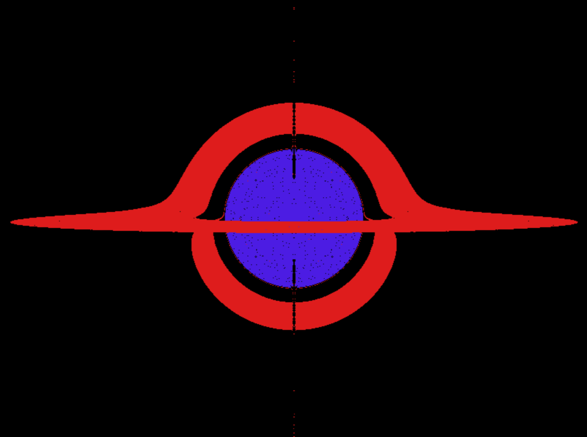
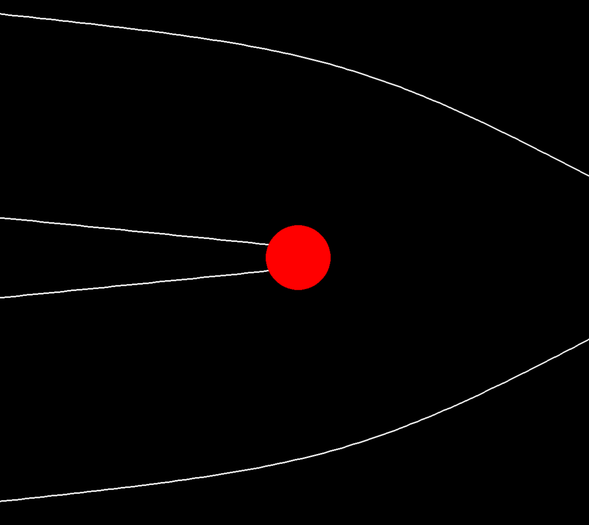

# Black Hole (2D/3D)

### [Download](https://github.com/C-users-quad/black-hole/releases/latest)

## Overview

This simulates how black holes bend light near them in both 2d and 3d.

    
     
    <em>Black hole rendered via compute shader in OpenGL</em>

    
     
    <em>Trails of light rays (white) that bended around black hole (red)</em>

## How it works

### In the 2D version:

 - I step the rays in real time* using the Schwarzschild geodesic equation in 2D

\*the program allows you to observe the evolution of the ray's position with use of the trail

Note: it was more like a proof-of-concept for me its not very \"complete\"

### In the 3D version:

 - The camera is modelled as a pinhole camera
 - Rays start from the cameras position shooting outward from every pixel toward the black hole
 - Every frame is rendered by determining the outcome of each of the pixel's ray's trajectories:
   - If the ray escapes the black hole, the pixel is black
   - If the ray crosses the event horizon, the pixel is blue
   - If the ray intersects the accretion disc, the pixel is red
 - Ray trajectories are evolved using the Schwarzschild geodesic equation in 3D

## Controls

 - **WASD** pans camera
 - **SCROLL** zooms camera
